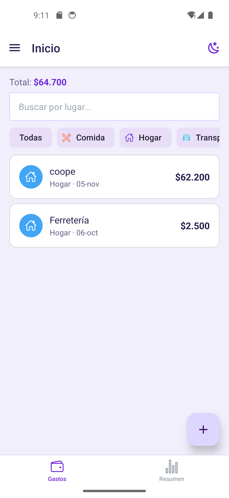
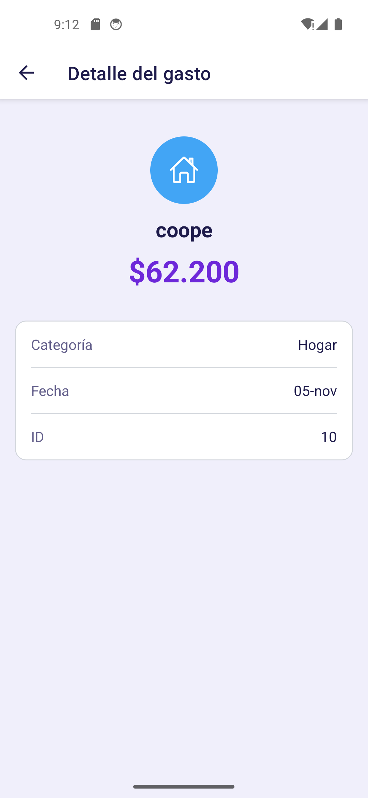
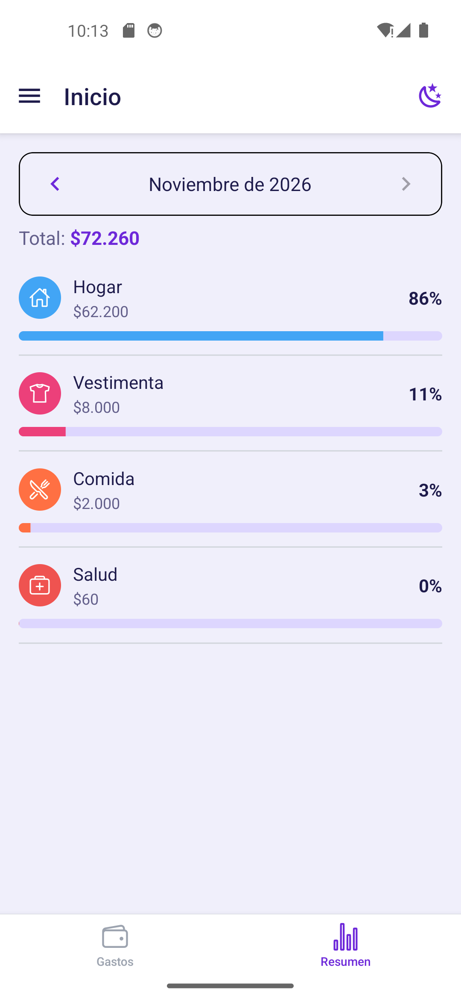

# Gastos App — SDK 54 · Navegación y animaciones (Clase 10)

Aplicación de registro de gastos en **Expo SDK 54 / React Native** con **Drawer + Tabs**, **tema global claro/oscuro persistido**, una **paleta de marca centralizada**, animaciones con Reanimated y persistencia en **Cloud Firestore**.

## Cómo correr

Requisitos: Node.js, npm y, para Android, un emulador o dispositivo con la app **Expo Go**.

```bash
# 1. Dependencias (desde la raíz)
npm install

# 2. Configurar Firebase
cp .env.example .env
# Editá .env con la config web de tu proyecto Firebase

# 3. App
npm start
# o directamente:
npm run android
npm run ios
npm run web
```

Si cambiás las variables de Firebase, reiniciá Metro con caché limpia:

```bash
npx expo start -c
```

## Configurar Firebase

1. En Firebase Console, abrir el proyecto `gastos-app-sdk54`.
2. Crear **Firestore Database** en modo **test** y elegir una región.
3. En **Project settings → Your apps**, registrar una app **Web** y copiar el objeto `firebaseConfig`.
4. Completar `.env` con esos valores:

```env
EXPO_PUBLIC_FIREBASE_API_KEY=...
EXPO_PUBLIC_FIREBASE_AUTH_DOMAIN=gastos-app-sdk54.firebaseapp.com
EXPO_PUBLIC_FIREBASE_PROJECT_ID=gastos-app-sdk54
EXPO_PUBLIC_FIREBASE_STORAGE_BUCKET=gastos-app-sdk54.firebasestorage.app
EXPO_PUBLIC_FIREBASE_MESSAGING_SENDER_ID=...
EXPO_PUBLIC_FIREBASE_APP_ID=...
```

El archivo `.env` es local y está ignorado por Git.

La instancia de Firestore se inicializa en `app/config/firebase.ts` con `useFetchStreams: false`, `experimentalForceLongPolling: true` y `experimentalAutoDetectLongPolling: false`. React Native no soporta completamente los fetch streams del build web de Firebase y el transporte WebChannel puede fallar en el emulador; con long polling forzado Firestore usa requests HTTP comunes en vez de streams persistentes.

Los gastos se guardan en la colección `gastos` de Firestore:

```json
{
  "lugar": "Supermercado",
  "categoria": "comida",
  "monto": 12500,
  "fecha": "2026-11-20",
  "comprobanteUri": "file:///.../comprobante-....jpg"
}
```

El `id` del gasto es el `id` del documento de Firestore. El modo test deja lecturas y escrituras abiertas solo para desarrollo; configura reglas reales antes de publicar.

Los comprobantes siguen siendo archivos locales del dispositivo. Por eso, al abrir un gasto creado en otro dispositivo, se muestra el placeholder “Comprobante no disponible en este dispositivo”.

El directorio `server/` queda como referencia del anterior API REST local, pero la app ya no lo usa.

## Capturas

Capturas tomadas desde el emulador Android (`assets/screenshots/`).

| Gastos | Detalle | Nuevo gasto |
| --- | --- | --- |
|  |  |  |

| Resumen mensual | Comprobante adjunto |
| --- | --- |
|  |  |

## Qué se aplicó en esta clase

- **Menú lateral (Drawer)** con “Inicio”, “Estadísticas” y “Ajustes”, y **pestañas (Tabs)** para Gastos y Resumen.
- **Estadísticas por categoría** con selector de período “Todo”/“Mes” y gráfico de barras horizontales.
- Navegación anidada **Stack ⊃ Drawer ⊃ Tabs** con `expo-router`.
- **Detalle** y **Nuevo gasto** apilados sobre el Drawer, con header propio respetuoso del área segura.
- **Persistencia en Firestore**: lectura y escritura de gastos desde hooks, sin servidor local.
- **Animaciones** de entrada en cascada, reacomodo de listas y transición `fade` entre pestañas.
- Tema claro/oscuro global controlado por un `ThemeProvider` propio y **persistido con AsyncStorage**.
- **Paleta centralizada**: todos los `#` de color viven en `constants/theme.ts`.
- Traducción automática de la paleta al tema Material 3 de `react-native-paper`.
- `Text` y `TextInput` de Paper para que tipografías e inputs hereden el tema, y `getPaperTheme()` memoizado para no recrear el tema en cada render.
- `StatusBar` que invierte el color de los íconos según el tema.
- Colores de las categorías del catálogo (comida, hogar, transporte…).

### Tipado y hooks de navegación

- El proyecto usa `"strict": true` en `tsconfig.json` y no deja `any` en los componentes.
- `constants/navigation.ts` define `RootStackParamList` y reutiliza `NativeStackScreenProps` para obtener los tipos de `route` y `navigation`.
- `components/DetalleContenido.tsx` es un componente hijo (no una pantalla) que usa `useRoute<DetalleRouteProp>()` y `useNavigation<DetalleNavigationProp>()`.
- Desde ese componente hijo se ejecuta `navigation.push("crear")` con el botón “Agregar otro gasto”.
- En el listado se mantiene `router.push()` de Expo Router, que es el equivalente de `navigation.push()` en este proyecto.
- `ScreenWrapper` tiene sus props tipadas con una interfaz (`children`, `title`, `withScroll`).

### Regla de oro

> Ningún color con `#` fuera de `constants/theme.ts`.

Si un componente necesita un color, siempre sale de `useTheme()` (colores de marca) o de `categoryColors` (categoría). Así el tema se mantiene consistente y es fácil de cambiar.

## Mapa de navegación

```
Stack raíz (app/_layout.tsx)
├── (drawer)                    ← menú lateral
│   ├── (tabs)                  ← pestañas
│   │   ├── index.tsx           ← Gastos
│   │   └── resumen.tsx         ← Resumen
│   ├── estadisticas.tsx        ← estadísticas por categoría
│   └── ajustes.tsx             ← tema claro/oscuro
├── detalle.tsx                 ← se apila con flecha para volver
└── crear.tsx                   ← card en Android / modal en iOS; sube desde abajo
```

## Archivos clave

```
constants/theme.ts              # Paleta de marca (light/dark), colores de categorías, getPaperTheme()
constants/navigation.ts         # RootStackParamList y tipos basados en NativeStackScreenProps
context/ThemeContext.tsx        # ThemeProvider + hook useTheme()
hooks/useStoredState.ts         # useState persistido en AsyncStorage
app/_layout.tsx                 # GestureHandlerRootView + providers + Stack raíz
app/(drawer)/_layout.tsx        # Menú lateral
app/(drawer)/(tabs)/_layout.tsx # Barra de pestañas
app/(drawer)/estadisticas.tsx   # Estadísticas por categoría
components/                     # GastoItem, ScreenWrapper, ComprobanteAdjunto, DetalleContenido, CategoriaBarChart
styles/sharedStyles.ts          # Espaciados, radios y estilos compartidos
```

### `constants/theme.ts`

- **`lightColors`** — paleta clara: fondo violeta/grisáceo suave, tarjetas blancas, texto azul/violeta muy oscuro, acento púrpura `#6D28D9`.
- **`darkColors`** — paleta oscura del mismo tipo (`Colors`): fondo violeta nocturno profundo, superficies elevadas, acento violeta pastel `#A78BFA`.
- **`categoryColors`** — un color por categoría (comida, hogar, transporte, salud, educación, vestimenta, servicios, entretenimiento, impuestos, mascotas, otro).
- **`getPaperTheme(colors, scheme)`** — construye un `MD3Theme` para `react-native-paper` usando como base el tema claro u oscuro de Paper y sobreescribiendo sus `colors` con la paleta de marca (`primary`, `surface`, `background`, `elevation`, etc.).

```tsx
import { useMemo } from "react";
import { getPaperTheme } from "@/constants/theme";

// colors: lightColors | darkColors
const paperTheme = useMemo(() => getPaperTheme(colors, theme), [colors, theme]);
```

### `context/ThemeContext.tsx`

- **`ThemeProvider`** — guarda el estado del tema (`"light" | "dark"`) y lo comparte por Context. Lo persiste en `AsyncStorage` con la clave `@gastos:theme`, así sobrevive al reinicio de la app.
- **`useTheme()`** — hook propio que devuelve `{ theme, colors, toggleTheme }`. Lanza un error si se usa fuera de un `<ThemeProvider>`.
- **¿Por qué `useMemo` y `useCallback`?** — sin `useMemo`, `value` sería un objeto nuevo en cada render del Provider y **todos** los consumidores se re-renderizarían aunque el tema no cambiara. `useCallback` mantiene estable la identidad de `toggleTheme`.

```tsx
const { theme, colors, toggleTheme } = useTheme();
```

### `app/_layout.tsx`

Orden de providers:

```tsx
<GestureHandlerRootView style={{ flex: 1 }}>
  <ThemeProvider>
    <SafeAreaProvider>
      <PaperProvider theme={paperTheme}>
        <StatusBar style={theme === "dark" ? "light" : "dark"} />
        <Stack>
          <Stack.Screen name="(drawer)" options={{ headerShown: false }} />
          <Stack.Screen name="detalle" options={{ title: "Detalle del gasto" }} />
          <Stack.Screen
            name="crear"
            options={{
              title: "Nuevo gasto",
              presentation: Platform.OS === "ios" ? "modal" : "card",
              animation: "slide_from_bottom",
            }}
          />
        </Stack>
      </PaperProvider>
    </SafeAreaProvider>
  </ThemeProvider>
</GestureHandlerRootView>
```

- `GestureHandlerRootView` → necesario para que el Drawer detecte el gesto de deslizar.
- `SafeAreaProvider` → necesario para `SafeAreaView`.
- `PaperProvider` → aplica la paleta de marca a `react-native-paper`.
- `StatusBar` → fondo oscuro → íconos claros, y viceversa.
- `Stack` → navegador raíz; el Drawer y las Tabs viven dentro de `(drawer)`.
