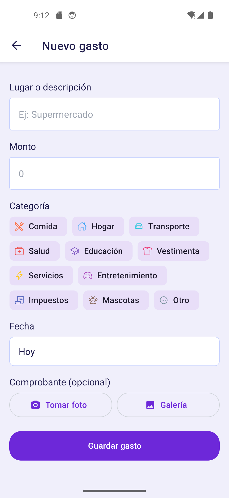
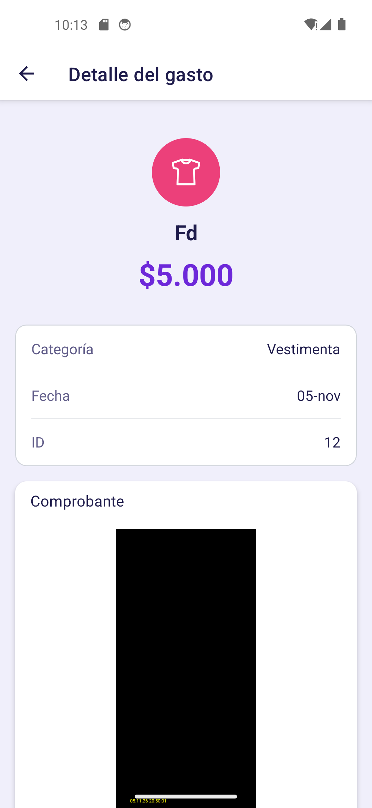
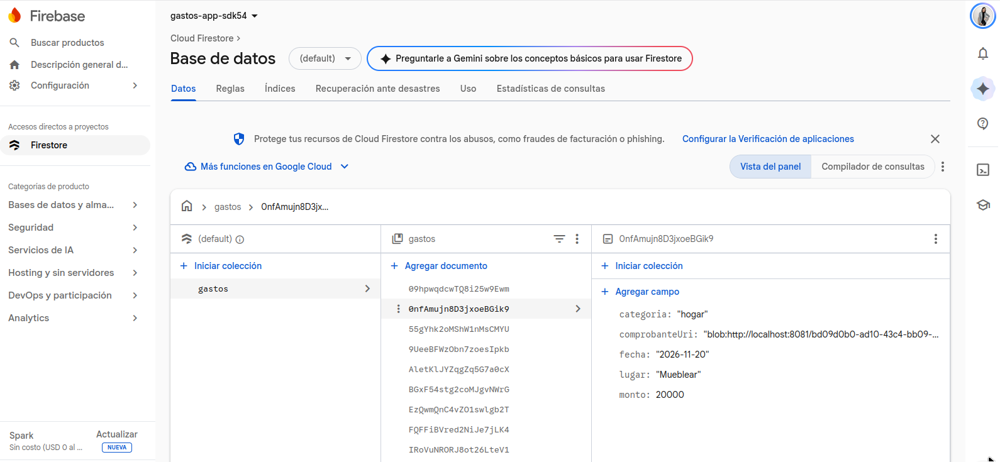
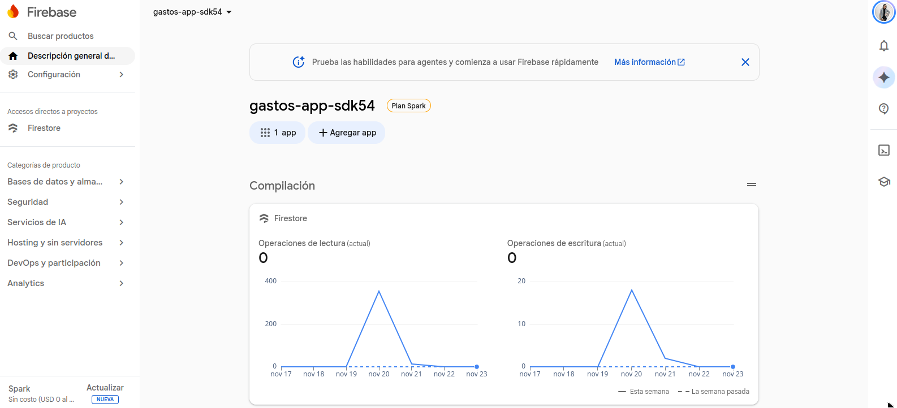

# Gastos App — SDK 54 · Proyecto final

Aplicación de registro de gastos en **Expo SDK 54 / React Native** con **Drawer + Tabs**, **tema global claro/oscuro persistido**, una **paleta de marca centralizada**, animaciones con Reanimated, persistencia en **Cloud Firestore**, diálogos compatibles con web y builds Android `.apk` con **EAS Build**.

## Cómo correr

Requisitos: Node.js, npm y, para Android, un emulador o dispositivo con la app **Expo Go**.

```bash
# 1. Dependencias (desde la raíz)
npm install

# 2. Configurar Firebase
cp .env.example .env
# Editá .env con la config web de tu proyecto Firebase

# 3. App
npm start
# o directamente:
npm run android
npm run ios
npm run web
```

Si cambiás las variables de Firebase, reiniciá Metro con caché limpia:

```bash
npx expo start -c
```

## Configurar Firebase

1. En Firebase Console, abrir el proyecto `gastos-app-sdk54`.
2. Crear **Firestore Database** en modo **test** y elegir una región.
3. En **Project settings → Your apps**, registrar una app **Web** y copiar el objeto `firebaseConfig`.
4. Completar `.env` con esos valores:

```env
EXPO_PUBLIC_FIREBASE_API_KEY=...
EXPO_PUBLIC_FIREBASE_AUTH_DOMAIN=gastos-app-sdk54.firebaseapp.com
EXPO_PUBLIC_FIREBASE_PROJECT_ID=gastos-app-sdk54
EXPO_PUBLIC_FIREBASE_STORAGE_BUCKET=gastos-app-sdk54.firebasestorage.app
EXPO_PUBLIC_FIREBASE_MESSAGING_SENDER_ID=...
EXPO_PUBLIC_FIREBASE_APP_ID=...
```

El archivo `.env` es local y está ignorado por Git.

La instancia de Firestore se inicializa en `app/config/firebase.ts` con `useFetchStreams: false`, `experimentalForceLongPolling: true` y `experimentalAutoDetectLongPolling: false`. React Native no soporta completamente los fetch streams del build web de Firebase y el transporte WebChannel puede fallar en el emulador; con long polling forzado Firestore usa requests HTTP comunes en vez de streams persistentes.

Los gastos se guardan en la colección `gastos` de Firestore:

```json
{
  "lugar": "Supermercado",
  "categoria": "comida",
  "monto": 12500,
  "fecha": "2026-11-20",
  "comprobanteUri": "file:///.../comprobante-....jpg"
}
```

El `id` del gasto es el `id` del documento de Firestore. El modo test deja lecturas y escrituras abiertas solo para desarrollo; configura reglas reales antes de publicar.

Los comprobantes siguen siendo archivos locales del dispositivo. Por eso, al abrir un gasto creado en otro dispositivo, se muestra el placeholder “Comprobante no disponible en este dispositivo”.

El anterior API REST local fue eliminado: la app ya no depende de servidor propio, IPs locales ni variables de URL base.

## Comportamiento web y guardado

En web, `react-native-web` no implementa `Alert.alert` y `DateTimePicker` no está disponible. Por eso:

- La confirmación de borrado, los errores de permisos/cámara/galería, las validaciones y el resultado del alta usan `Dialog` + `Portal` de `react-native-paper`. Si Firestore falla, se muestra el mensaje real y se puede reintentar.
- La fecha se escribe como `DD-MM-AAAA` (acepta `-` o `/`) y se convierte a ISO `YYYY-MM-DD` antes de guardar en Firestore. En Android/iOS se mantiene `DateTimePicker`.
- Después de guardar **no se vuelve automáticamente** al listado: aparece “¡Éxito!” y el botón “Volver” ejecuta `router.back()`.
- Los hooks `use-post-gasto.tsx` y `use-delete-gasto.tsx` devuelven `{ ok, error }`, y `use-gastos.tsx` expone `getGastos` para reintentar la carga.

## Build / APK con EAS

El proyecto está asociado a la cuenta `nanhy` (`owner` en `app.json`) y al paquete Android `com.nanhy.gastosappsdk54`. El perfil `preview` de `eas.json` genera un `.apk` instalable (`android.buildType: apk`) con distribución interna.

Antes de buildiar, configurá las variables `EXPO_PUBLIC_FIREBASE_*` en el entorno `preview` de EAS (en el dashboard de Expo o con los comandos `eas env:*`). El archivo `.env` local está ignorado por Git y **no se sube** a EAS Build.

```bash
npm install -g eas-cli
eas login
eas whoami              # debe mostrar la cuenta nanhy
eas build -p android --profile preview
```

El artefacto descargable desde el dashboard de EAS es un `.apk` listo para instalar en un teléfono físico o emulador Android.

El build anterior (`e5116311-44e5-4ee0-81c2-4e1a83875a35`) no incluye los fixes de diálogos web, fecha editable ni manejo de errores; queda generar un `.apk` nuevo con este código.

## Capturas

Capturas de la app desde el emulador Android y del proyecto en Firebase Console (`assets/screenshots/`).

| Gastos | Detalle | Nuevo gasto |
| --- | --- | --- |
|  |  |  |

| Resumen mensual | Comprobante adjunto |
| --- | --- |
|  |  |

### Firebase

| Colección `gastos` en Firestore | Configuración web de Firebase |
| --- | --- |
|  |  |

Los documentos se guardan en la colección `gastos` de la base `(default)`; los valores de `firebaseConfig` se cargan desde `.env` mediante variables `EXPO_PUBLIC_FIREBASE_*`.

## Qué se aplicó en el proyecto

- **Menú lateral (Drawer)** con “Inicio”, “Estadísticas” y “Ajustes”, y **pestañas (Tabs)** para Gastos y Resumen.
- **Estadísticas por categoría** con selector de período “Todo”/“Mes” y gráfico de barras horizontales.
- Navegación anidada **Stack ⊃ Drawer ⊃ Tabs** con `expo-router`.
- **Detalle** y **Nuevo gasto** apilados sobre el Drawer, con header propio respetuoso del área segura.
- **Persistencia en Firestore**: lectura y escritura de gastos desde hooks, sin servidor local.
- **Animaciones** de entrada en cascada, reacomodo de listas y transición `fade` entre pestañas.
- Tema claro/oscuro global controlado por un `ThemeProvider` propio y **persistido con AsyncStorage**.
- **Paleta centralizada**: todos los `#` de color viven en `constants/theme.ts`.
- Traducción automática de la paleta al tema Material 3 de `react-native-paper`.
- `Text` y `TextInput` de Paper para que tipografías e inputs hereden el tema, y `getPaperTheme()` memoizado para no recrear el tema en cada render.
- `StatusBar` que invierte el color de los íconos según el tema.
- Colores de las categorías del catálogo (comida, hogar, transporte…).

### Tipado y hooks de navegación

- El proyecto usa `"strict": true` en `tsconfig.json` y no deja `any` en los componentes.
- `constants/navigation.ts` define `RootStackParamList` y reutiliza `NativeStackScreenProps` para obtener los tipos de `route` y `navigation`.
- `components/DetalleContenido.tsx` es un componente hijo (no una pantalla) que usa `useRoute<DetalleRouteProp>()` y `useNavigation<DetalleNavigationProp>()`.
- Desde ese componente hijo se ejecuta `navigation.push("crear")` con el botón “Agregar otro gasto”.
- En el listado se mantiene `router.push()` de Expo Router, que es el equivalente de `navigation.push()` en este proyecto.
- `ScreenWrapper` tiene sus props tipadas con una interfaz (`children`, `title`, `withScroll`).

### Regla de oro

> Ningún color con `#` fuera de `constants/theme.ts`.

Si un componente necesita un color, siempre sale de `useTheme()` (colores de marca) o de `categoryColors` (categoría). Así el tema se mantiene consistente y es fácil de cambiar.

Excepción documentada: `app.json` conserva tres colores literales (`#E6F4FE` en el icono adaptativo y `#ffffff`/`#000000` en el splash). Expo los consume como configuración nativa antes de cargar el código JavaScript, por lo que no pueden importarse desde `constants/theme.ts`. La regla se aplica íntegramente a `.ts`/`.tsx`.

## Desarrollo de temas de la cursada

### Navegación

La navegación se armó con `expo-router` en tres niveles: el `Stack` raíz (`app/_layout.tsx`) apila `crear` y `detalle` sobre el `Drawer` (`app/(drawer)/_layout.tsx`), que contiene `estadisticas` y `ajustes`; dentro de `(tabs)` (`app/(drawer)/(tabs)/_layout.tsx`) viven `Gastos` y `Resumen`. El tipado usa `RootStackParamList` (`constants/navigation.ts`) y `useRoute`/`useNavigation` desde componentes hijos, mientras el listado usa `router.push()`.

### Persistencia

Los gastos se guardan en Cloud Firestore: `app/config/firebase.ts` inicializa la app con long polling, `constants/api.ts` concentra `getGastos`, `createGasto` y `deleteGasto`, y los hooks `use-gastos`, `use-post-gasto` y `use-delete-gasto` exponen estados y resultados a la UI. Las preferencias del dispositivo se guardan con `AsyncStorage` mediante `hooks/useStoredState.ts`. Los comprobantes se copian de la caché a `Paths.document/comprobantes` en `constants/files.ts`.

### Theming y componentes

`constants/theme.ts` define `lightColors`, `darkColors` y `categoryColors`; `getPaperTheme()` traduce esa paleta a roles MD3, incluidos los niveles de `elevation`. `context/ThemeContext.tsx` comparte el tema con `useMemo`/`useCallback` y lo persiste con `AsyncStorage`. La UI usa `Text`, `TextInput`, `Button`, `Dialog` y `Portal` de React Native Paper, por lo que hereda el tema sin pintar colores a mano; los únicos hex fuera de `theme.ts` son la excepción nativa de `app.json`.

### Componentes nativos y comprobantes

`components/ComprobanteAdjunto.tsx` usa `expo-camera` y `expo-image-picker`, pide permisos, reacciona a `AppState` al volver de Ajustes y ofrece `Linking.openSettings()` cuando `canAskAgain` es falso. La imagen temporal se persiste antes del guardado y se muestra con `ComprobanteImage`. Las confirmaciones y errores usan `Dialog` porque `Alert` no funciona en web.

### Animaciones

Se usan `FadeInDown` con `delay` en listas y formularios, `LinearTransition` para reacomodar filas al filtrar o cambiar de mes y `ZoomIn.springify()` para abrir detalle y ajustes; las Tabs usan transición `fade`.

### Hooks, validación y errores

Los hooks exponen `loading`/`error` y devuelven `{ ok, error }` para que la pantalla decida qué mostrar, sin relanzar excepciones. Antes de guardar se validan lugar, categoría, monto (`Number.isNaN`/`<= 0`) y fecha (`esFechaISOValida`); en web, `DD-MM-AAAA` se convierte a ISO. Los `catch` usan `e instanceof Error` con mensaje fallback.

### Build y QA

El perfil `preview` de `eas.json` genera `.apk` con EAS; el repositorio incluye capturas en `assets/screenshots/`, la ficha de alcance en `documentacion/` y los chequeos `npx tsc --noEmit`, `npm run lint` y exports de Expo. La validación en dispositivo físico/emulador queda como paso final de entrega.

## Mapa de navegación

```
Stack raíz (app/_layout.tsx)
├── (drawer)                    ← menú lateral
│   ├── (tabs)                  ← pestañas
│   │   ├── index.tsx           ← Gastos
│   │   └── resumen.tsx         ← Resumen
│   ├── estadisticas.tsx        ← estadísticas por categoría
│   └── ajustes.tsx             ← tema claro/oscuro
├── detalle.tsx                 ← se apila con flecha para volver
└── crear.tsx                   ← card en Android / modal en iOS; sube desde abajo
```

## Archivos clave

```
constants/theme.ts              # Paleta de marca (light/dark), colores de categorías, getPaperTheme()
constants/navigation.ts         # RootStackParamList y tipos basados en NativeStackScreenProps
app/config/firebase.ts          # Inicialización de Firebase App y Firestore
constants/api.ts                # getGastos, createGasto y deleteGasto contra Cloud Firestore
constants/gastos.ts             # Modelo Gasto y nombre de la colección
hooks/use-gastos.tsx            # Listado de gastos
hooks/use-post-gasto.tsx        # Alta de gastos
hooks/use-delete-gasto.tsx      # Eliminación de gastos
context/ThemeContext.tsx        # ThemeProvider + hook useTheme()
hooks/useStoredState.ts         # useState persistido en AsyncStorage
app/_layout.tsx                 # GestureHandlerRootView + providers + Stack raíz
app/(drawer)/_layout.tsx        # Menú lateral
app/(drawer)/(tabs)/_layout.tsx # Barra de pestañas
app/(drawer)/estadisticas.tsx   # Estadísticas por categoría
components/                     # GastoItem, ScreenWrapper, ComprobanteAdjunto, DetalleContenido, CategoriaBarChart
styles/sharedStyles.ts          # Espaciados, radios y estilos compartidos
eas.json                        # Perfil preview con android.buildType: apk
```

## Documentación

- [Ficha de alcance — Gastos App](./documentacion/Ficha%20de%20alcance%20-%20Gastos%20App.md)

## Correcciones aplicadas

| Observación | Cómo quedó |
| :--- | :--- |
| `db.json`, `10.0.2.2`, `EXPO_PUBLIC_API_URL`, puerto `3000` y `/users` | Servidor eliminado: la app usa Firestore y `.env` solo contiene variables `EXPO_PUBLIC_FIREBASE_*`. |
| `usePostGasto` y alta | `loading`/`error` + retorno `{ ok, error }`; la pantalla muestra `Dialog`, no `Alert`. |
| Validación de monto y fecha | `Number.isNaN`/`<= 0` y `esFechaISOValida` antes de guardar; fecha web `DD-MM-AAAA` convertida a ISO. |
| `err: any` | Ninguno: los `catch` usan `e instanceof Error` con mensaje fallback. |
| Theming | MD3 con `elevation`, `useMemo`/`useCallback`, regla del color y excepción nativa documentada arriba. |
| FAB, Paper y orden | FAB con `primary`/`onPrimary`, `Text`/`TextInput` de Paper y copia del array antes de `.sort()`. |
| Permisos y comprobantes | `AppState` re-lee permisos, `!canAskAgain` abre configuración y la imagen se copia a `documentDirectory`. |
| README | Instrucciones de ejecución, Firebase, EAS, ficha de alcance y capturas. |

### `constants/theme.ts`

- **`lightColors`** — paleta clara: fondo violeta/grisáceo suave, tarjetas blancas, texto azul/violeta muy oscuro, acento púrpura `#6D28D9`.
- **`darkColors`** — paleta oscura del mismo tipo (`Colors`): fondo violeta nocturno profundo, superficies elevadas, acento violeta pastel `#A78BFA`.
- **`categoryColors`** — un color por categoría (comida, hogar, transporte, salud, educación, vestimenta, servicios, entretenimiento, impuestos, mascotas, otro).
- **`getPaperTheme(colors, scheme)`** — construye un `MD3Theme` para `react-native-paper` usando como base el tema claro u oscuro de Paper y sobreescribiendo sus `colors` con la paleta de marca (`primary`, `surface`, `background`, `elevation`, etc.).

```tsx
import { useMemo } from "react";
import { getPaperTheme } from "@/constants/theme";

// colors: lightColors | darkColors
const paperTheme = useMemo(() => getPaperTheme(colors, theme), [colors, theme]);
```

### `context/ThemeContext.tsx`

- **`ThemeProvider`** — guarda el estado del tema (`"light" | "dark"`) y lo comparte por Context. Lo persiste en `AsyncStorage` con la clave `@gastos:theme`, así sobrevive al reinicio de la app.
- **`useTheme()`** — hook propio que devuelve `{ theme, colors, toggleTheme }`. Lanza un error si se usa fuera de un `<ThemeProvider>`.
- **¿Por qué `useMemo` y `useCallback`?** — sin `useMemo`, `value` sería un objeto nuevo en cada render del Provider y **todos** los consumidores se re-renderizarían aunque el tema no cambiara. `useCallback` mantiene estable la identidad de `toggleTheme`.

```tsx
const { theme, colors, toggleTheme } = useTheme();
```

### `app/_layout.tsx`

Orden de providers:

```tsx
<GestureHandlerRootView style={{ flex: 1 }}>
  <ThemeProvider>
    <SafeAreaProvider>
      <PaperProvider theme={paperTheme}>
        <StatusBar style={theme === "dark" ? "light" : "dark"} />
        <Stack>
          <Stack.Screen name="(drawer)" options={{ headerShown: false }} />
          <Stack.Screen
            name="detalle"
            options={{ title: "Detalle del gasto", headerShown: false }}
          />
          <Stack.Screen
            name="crear"
            options={{
              title: "Nuevo gasto",
              headerShown: false,
              presentation: Platform.OS === "ios" ? "modal" : "card",
              animation: "slide_from_bottom",
            }}
          />
        </Stack>
      </PaperProvider>
    </SafeAreaProvider>
  </ThemeProvider>
</GestureHandlerRootView>
```

- `GestureHandlerRootView` → necesario para que el Drawer detecte el gesto de deslizar.
- `SafeAreaProvider` → necesario para `SafeAreaView`.
- `PaperProvider` → aplica la paleta de marca a `react-native-paper`.
- `StatusBar` → fondo oscuro → íconos claros, y viceversa.
- `Stack` → navegador raíz; el Drawer y las Tabs viven dentro de `(drawer)`.
